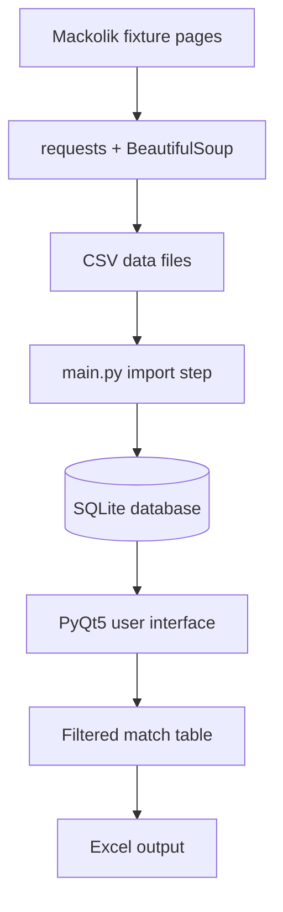

# Football Match Result Prediction Software System

This project automatically collects historical football match data from European and Turkish leagues, stores it in a SQLite database, and enables filtering through a PyQt5 desktop interface. It is designed to prepare match data for analytics, reporting, and machine learning workflows.

The system was developed as a group project and is centered around web scraping, data management, and desktop application integration.

## Table of Contents

- [Project Overview](#project-overview)
- [Features](#features)
- [System Flow](#system-flow)
- [Supported Leagues](#supported-leagues)
- [Technology Stack](#technology-stack)
- [Project Structure](#project-structure)
- [Installation](#installation)
- [Running the Application](#running-the-application)
- [Database Schema](#database-schema)
- [Data Export](#data-export)
- [Use Cases](#use-cases)
- [Future Improvements](#future-improvements)
- [Notes](#notes)

## Project Overview

The Football Match Result Prediction Software System is a desktop application that gathers historical match data from football fixtures and presents it in a structured format for analysis. The application allows users to query results by date, league, season, teams, and score, then save the filtered dataset as an Excel file.

The workflow is as follows:

1. Fixture pages for target leagues are accessed.
2. HTML content is parsed.
3. Season, date, team, and score values are extracted.
4. Data is saved to CSV files.
5. CSV files are imported into a SQLite database.
6. The user interface filters and displays the data.
7. The result can be exported to Excel format if needed.

## Features

- Historical football match data scraping
- Multi-league support
- Date, league, season, team, and score-based filtering
- SQLite database storage
- PyQt5 desktop user interface
- CSV export support
- Excel (.xlsx) export support
- Data preparation for analysis and model training

## System Flow



## Supported Leagues

The project targets the following leagues for data collection:

- Bundesliga
- Premier League
- Ligue 1
- Serie A
- La Liga
- Süper Lig

## Technology Stack

- Python 3.x
- PyQt5
- SQLite3
- pandas
- openpyxl
- requests
- BeautifulSoup4
- lxml
- CSV file processing

## Project Structure

```text
football-match-result-prediction-software-system/
├── README.md
├── requirements.txt
├── main.py
├── football.py
├── football.ui
├── footballveritabani.db
├── TopluTumLigler/
│   └── TopluTumLigler.py
├── data/
│   ├── README.md
│   ├── main.py
│   ├── football.py
│   ├── football.ui
│   ├── footballveritabani.db
│   ├── FinalCode.py
│   ├── mac_verileri_*.csv
│   └── updated_mac_verileri.csv
└── __pycache__/
```

### Main files

- `main.py`: manages the main application flow; reads data, imports it into the database, and fills the table.
- `football.py`: contains the PyQt interface classes.
- `football.ui`: Qt Designer layout file.
- `TopluTumLigler/TopluTumLigler.py`: scraping module that extracts match data from the web.
- `footballveritabani.db`: SQLite database used to store match data.

## Installation

### Requirements

- Python 3.10 or later
- pip package manager
- Internet access

### Step-by-step installation

1. Go to the project folder:

```bash
cd football-match-result-prediction-software-system
```

2. Create a virtual environment:

```bash
python -m venv venv
```

3. Activate the environment:

Windows:

```bash
venv\Scripts\activate
```

Linux/macOS:

```bash
source venv/bin/activate
```

4. Install dependencies:

```bash
pip install -r requirements.txt
```

## Running the Application

To start the project, run:

```bash
python main.py
```

When started, the application attempts to fetch data automatically and prepare the database. After that, the user interface opens and filter operations become available.

## Database Schema

The application uses the following table structure in the database:

```sql
CREATE TABLE IF NOT EXISTS mac_indeksleri3 (
    id INTEGER NOT NULL PRIMARY KEY AUTOINCREMENT,
    LeaugePlayed TEXT NOT NULL,
    Season TEXT NOT NULL,
    Date TEXT NOT NULL,
    HomeTeam TEXT NOT NULL,
    Score TEXT NOT NULL,
    AwayTeam TEXT NOT NULL
);
```

These columns represent:

- `LeaugePlayed`: league name
- `Season`: season label
- `Date`: match date
- `HomeTeam`: home team
- `Score`: match score
- `AwayTeam`: away team

## Data Export

The application can export the selected records into an Excel file named `mac_indeksleri3.xlsx`. This is useful for later analysis, reporting, or ingestion into another data pipeline.

## Use Cases

- Query matches for a specific date range
- Analyze league performance by season
- Filter by home and away teams
- Search for matches by exact score
- Export the result set to Excel

## Future Improvements

This project has strong potential for future enhancement. Possible improvements include:

- Machine-learning-based match outcome prediction
- Support for more leagues and seasons
- Data cleaning and normalization module
- Graphical statistical dashboards
- Error logging and validation system
- Improved scraping automation and reliability

## Notes

- Since this project fetches data from online sources, it should be used in accordance with the target website's terms and conditions.
- Large scraping operations may trigger access restrictions or timeouts.
- Data should be cleaned and validated before being used for model training or statistical analysis.

## Closing Note

This system is designed to collect, organize, store, and present football match data in a complete pipeline. It is especially valuable as a data preparation layer for machine learning and statistical analysis workflows.
